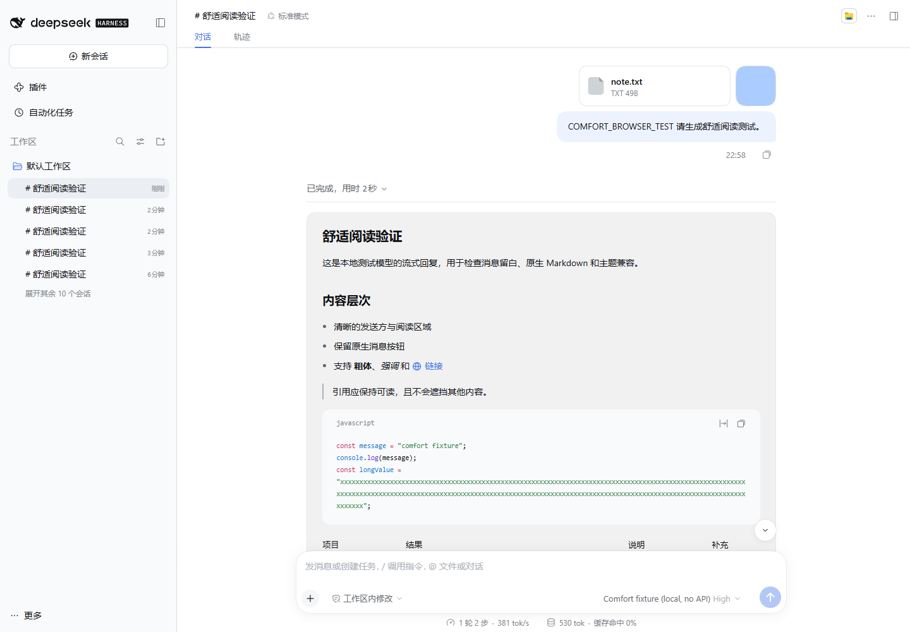
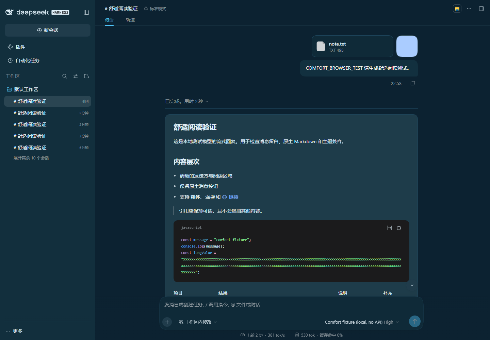

# Chat Comfort

[简体中文](README.md) · [Download v1.0.3](https://github.com/379385796-sys/dsh-chat-comfort/releases/tag/v1.0.3) · [Compatibility](docs/COMPATIBILITY.md)

More comfortable chat bubbles, line spacing, and reading space for DSH. Keep the host's width, font size, and theme controls, with **Comfortable / Compact** density options.

## Reading experience

- Adjust user-bubble corners, padding, and line spacing; add a reading surface around assistant replies.
- Follow host theme colors, including light/dark themes and narrow windows.
- Switch off the enhancement to return to native styling.
- Apply styles only when a complete reviewed component fingerprint matches. Unknown or mixed builds keep the native interface.

These existing images are **historical 1.0.x examples using synthetic offline conversations**, not real user content or current RC5 acceptance screenshots:





## Installation and compatibility

Current version: **1.0.3**. The package declares DSH `0.2.1-rc.2 || 0.2.1-rc.3 || 0.2.1-rc.5` and Node **22+**. Windows Desktop RC5 is the current target; its three reviewed chat styles match RC3, so the RC3 adapter is reused. An identical version label does not certify an unknown component build. Other platforms are untested.

1. Download `dsh-chat-comfort-1.0.3.tgz` and its `.sha256` from [v1.0.3](https://github.com/379385796-sys/dsh-chat-comfort/releases/tag/v1.0.3).
2. Run `Get-FileHash -Algorithm SHA256 -LiteralPath '<absolute-tgz-path>'` and compare the checksum.
3. Install the local tgz through DSH's plugin manager, or use a configured CLI:

   ```text
   dsh plugin --profile <profile> add <absolute-tgz-path>
   ```

4. Restart DSH and verify package `dsh-chat-comfort`, entry ID `chat-comfort`, version `1.0.3`.

Keep the previous package and configuration before updating. Prebuilt `lib/` files are included; no local build or other DSH series plugin is required.

## Usage

Open **Settings → Chat Comfort**, enable the enhancement, and select Comfortable or Compact. The panel reports Active, Off, Unsupported build, or Enhancement stopped. Adjust width, font size, and Appearance colors in host settings.

Enable/density preferences use the current client's `localStorage`. If storage is unavailable, changes last for the session only. Cross-device or cross-client synchronization is not promised.

## FAQ

**Installed, but nothing changed?** Check whether it is enabled. Unsupported build means a complete reviewed fingerprint was not found and native styling was retained. Do not force selectors to bypass the check. If the enhancement stopped, reload the plugin and retry.

**Does it change conversations or model behavior?** It manages its own style node and style observer. It does not read message text or take over input, session data, models, or permissions.

**Can I use Smooth Stream?** Dedicated evidence covers Smooth Stream 0.7.0 on historical RC2 only, not all RC5 or third-party combinations. See [compatibility](docs/COMPATIBILITY.md).

**How do I restore native styling or uninstall?** Turn off the enhancement, or use the manager or `dsh plugin --profile <profile> remove dsh-chat-comfort`. Disposal removes the instance's styles and observer; saved client density preferences are not guaranteed to be erased.

## Development and project information

DSH supplies Cordis, React, and client settings/slot interfaces. See [package.json](package.json) and [lockfile](pnpm-lock.yaml) for development dependencies. With Node.js 22+, configure caches, temporary directories, and the pnpm store, then run:

```text
pnpm install --frozen-lockfile --ignore-scripts
npm run check
```

The check includes build, type checking, style-safety checks, and tests. See [historical validation](docs/COMPATIBILITY.md) and [changelog](CHANGELOG.md).

An independently maintained DSH integration. See [MIT license](LICENSE) and [third-party notices](THIRD_PARTY_NOTICES.md).
