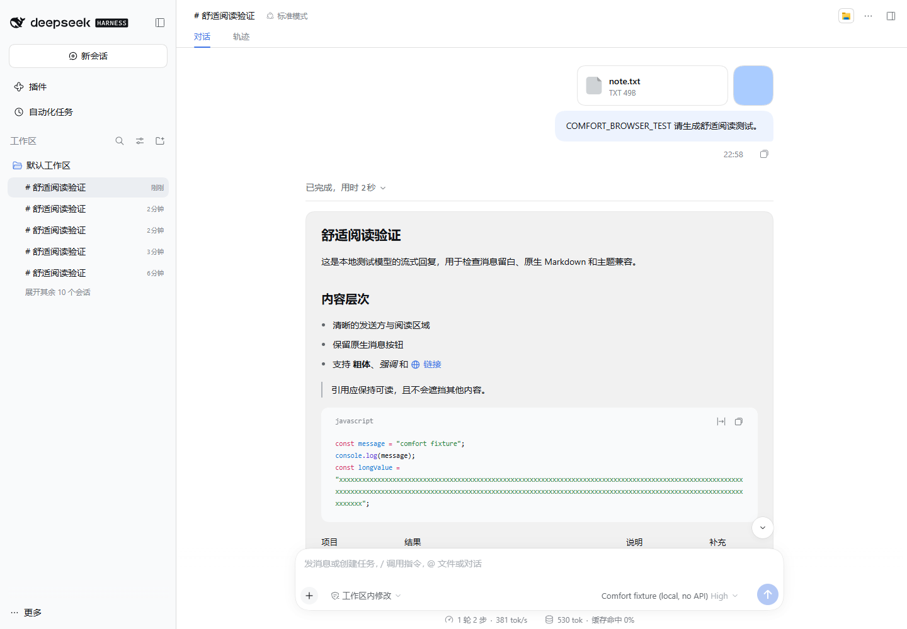
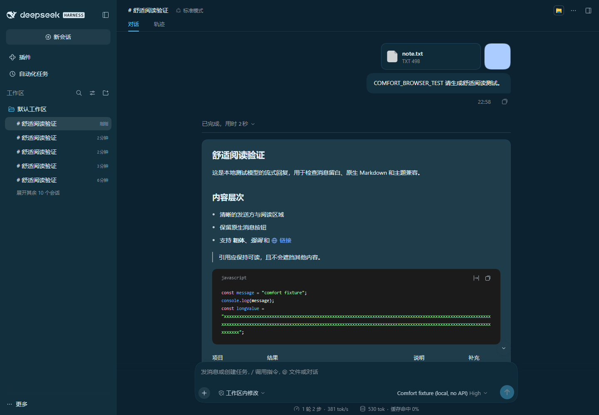

# 聊天体验优化（dsh-chat-comfort）

## 1.0.2 兼容性维护（2026-10-25）

宿主范围：`0.2.1-rc.2 || 0.2.1-rc.3`。本次以 Windows Desktop 0.2.1-rc.3 / Electron 44.7.0 / Node 24.21.0 实测。修复加载前版本拒绝及 RC3 聊天样式指纹变化，不新增功能。

隔离真实宿主、三插件与 Packer 0.4.2 共存、启停、设置与重启回归已验证；用户完成真实 Desktop GUI 验收。构建、类型检查、样式安全检查与 26 项回归通过；实际 RC3 消息样式、设置、滚动和菜单检查通过。保留原 RC2 支持及自动测试；本轮完整 RC2 Desktop 复测为 NOT TESTED。具体边界见 [兼容性记录](docs/COMPATIBILITY.md)。


[English](README.en.md)

以保守的样式适配改善 DSH 聊天气泡、行距和阅读区域。

独立维护的 DSH 插件。第三方代码和宿主参考材料保留各自的许可和署名。

## 兼容性与状态

版本 **1.0.2**。当前实测：Windows、DSH Desktop **0.2.1-rc.3**；保留此前 RC2 支持和自动回归，本轮 RC2 Desktop 全量复测为 NOT TESTED。其他平台未测试。

仅适配已核验的 Windows DSH Desktop RC2 / RC3 组件指纹。Smooth Stream 0.7.0 的专项兼容记录属于此前 RC2 验证；其他组合未经完整验证。指纹不匹配时保持原生界面。没有接管输入、会话数据、模型或权限。

## 安装与卸载

在 Releases 下载与本版本对应的预构建 tgz，先核对 SHA-256，再通过 DSH 官方插件界面选择该包，或执行：

```text
dsh plugin --profile <你的Profile> add <安装包完整路径>
```

重启 DSH 后，在插件管理器核对名称、ID 和版本。更新前备份自己的配置；不要手动修改 node_modules 或 app.asar。卸载使用插件管理器的卸载入口，或 `dsh plugin --profile <你的Profile> remove dsh-chat-comfort`。卸载不保证删除已导出的文件、历史或保留偏好。

## 使用

打开设置 → Chat Comfort，切换启用和“舒适 / 紧凑”密度。阅读宽度与字号继续使用宿主设置。

## 构建、测试与排错

安装 Node.js 22+，在本仓库目录配置工具缓存和 TEMP 后运行 `pnpm install --frozen-lockfile --ignore-scripts`、`npm run check`。

预构建 lib 已随源码保留，因此 GitHub 源码安装不需要运行安装期构建脚本。安装失败先检查 DSH 版本、Profile、包校验值和模块加载错误。不要通过关闭安全策略或覆盖宿主文件排错。完整范围见 [兼容与验证](docs/COMPATIBILITY.md)。

## 许可

见 [LICENSE](LICENSE)；第三方声明见对应许可文件。

## Screenshots / 截图

Synthetic offline conversation, not real user content; historical 1.0.x visual test. Host UI is shown for integration context.





## Plugin manager / 插件管理器

Actual isolated DSH 0.2.1-rc.2 interface, with no personal account, Profile path, or conversation content in the captured cards.


