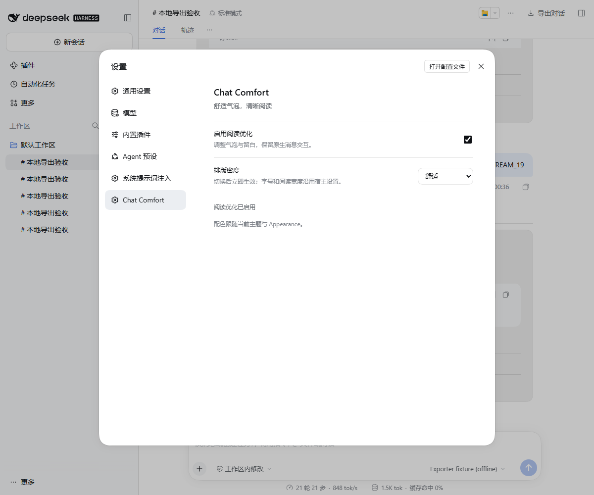
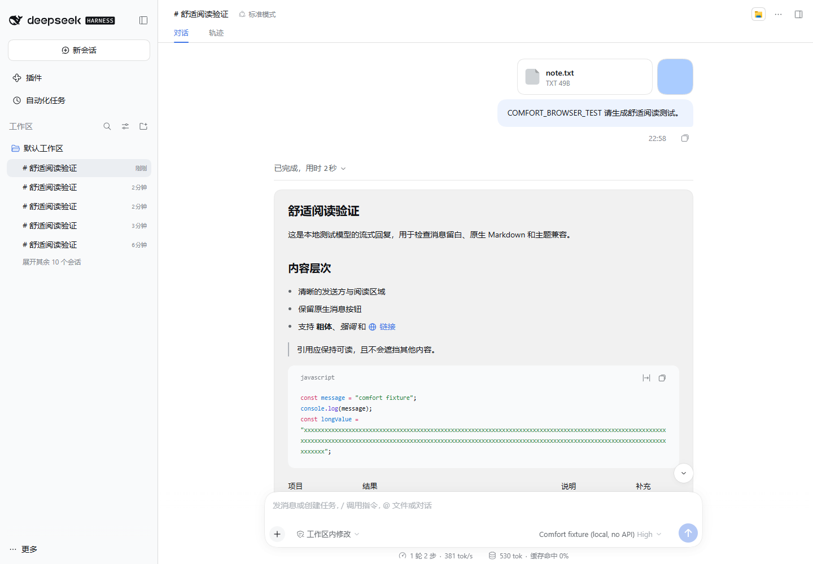
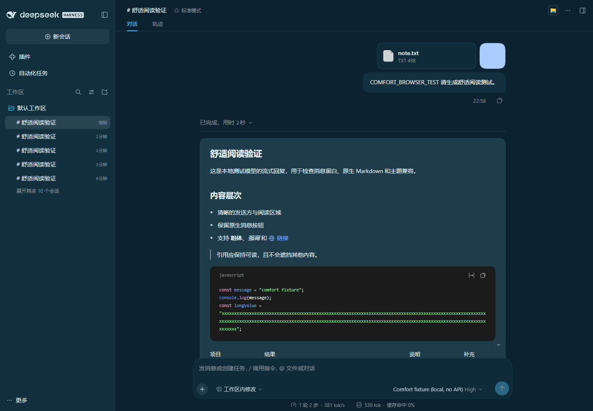

# Chat Comfort · 聊天阅读体验优化

[English](README.en.md) · [下载 v1.1.1](https://github.com/379385796-sys/dsh-chat-comfort/releases/tag/v1.1.1) · [兼容记录](docs/COMPATIBILITY.md)

让 DSH 聊天气泡、段落行距和阅读留白更舒适。保留宿主的阅读宽度、字号和主题设置，提供 **舒适 / 紧凑** 两种排版密度。

**1.1.1 更新：** 原生设置行、中文／英文界面和轻量控件反馈；偏好无法读取或保存时明确提示，当前阅读样式仍可正常生效。[更新记录](CHANGELOG.md)



## 阅读效果

- 调整用户气泡的圆角、内边距和行距，为助手回复增加阅读区域。
- 使用宿主主题颜色变量，兼顾明暗主题与窄窗口。
- 在设置中随时关闭增强，恢复原生显示。
- 只在已核验的组件样式指纹匹配时启用；未知或混合构建保留原生界面。

以下为仓库已有的 **1.0.x 历史合成会话示例**，不含真实用户对话，不代表当前 RC5 的实拍验收：





## 安装与兼容性

当前版本 **1.1.1**，包声明接受 DSH `0.2.1-rc.2 || 0.2.1-rc.3 || 0.2.1-rc.5 || 0.2.2-rc.1`，Node **22+**。当前目标为 Windows Desktop **0.2.2-rc.1**：其聊天样式沿用 RC3 的类名哈希，但用户气泡改为共享的 `UserMessageBubble` 原语（`data-message-bubble`），因此新增独立适配。版本号相同也不保证未知组件构建一定匹配；其他平台未验证。

1. 从 [v1.1.1 Release](https://github.com/379385796-sys/dsh-chat-comfort/releases/tag/v1.1.1) 下载 `dsh-chat-comfort-1.1.1.tgz` 和同名 `.sha256`。
2. 用 `Get-FileHash -Algorithm SHA256 -LiteralPath '<tgz完整路径>'` 计算哈希，与校验文件比较。
3. 在 DSH 插件管理器安装本地 tgz；若已配置 CLI，也可执行：

   ```text
   dsh plugin --profile <你的Profile> add <tgz完整路径>
   ```

4. 重启 DSH，确认包名 `dsh-chat-comfort`、入口 ID `chat-comfort`、版本为 `1.1.1`。

更新前保留旧包及配置。安装包包含预构建 `lib/`，使用时不需要自行构建，也不依赖另外三款 DSH 插件。

偏好保存在当前浏览器存储中。出现“本次设置已生效，但未能保存”时，重启可能恢复原设置；再次修改可重试保存。减少动态效果时，设置反馈直接显示，消息布局不会播放补间动画。

## 使用

打开 **设置 → Chat Comfort**，勾选“启用聊天美化”，选择“舒适”或“紧凑”。面板会显示 Active、Off、Unsupported build 或 Enhancement stopped 状态。阅读宽度、字号和 Appearance 配色继续在宿主设置中调整。

启用和密度偏好保存在当前客户端的 `localStorage`；本地存储不可用时仅在本次会话生效，不承诺跨设备或跨客户端同步。

## 常见问题

**安装了但没有变化？** 先确认面板启用状态。显示“当前组件构建未适配”时，插件没有找到完整的已核验样式指纹，会保留原生显示；不要强改选择器来绕过。显示“增强已安全停止”时可重新加载插件后重试。

**会修改对话或模型行为吗？** 实现只管理自己的样式节点和样式观察器，不读取消息正文，不接管输入、会话数据、模型或权限。

**能与 Smooth Stream 共用吗？** 专项记录仅覆盖历史 RC2 上的 Smooth Stream 0.7.0，不代表 RC5 或任意第三方组合均通过完整验证。详见[兼容记录](docs/COMPATIBILITY.md)。

**如何恢复原样或卸载？** 先在面板关闭增强；也可使用插件管理器，或 `dsh plugin --profile <你的Profile> remove dsh-chat-comfort` 卸载。卸载会清理本实例的样式与观察器，不保证清除客户端已保存的密度偏好。

## 开发与项目资料

宿主提供 Cordis、React 及客户端设置/插槽接口；开发依赖及其版本见 [package.json](package.json) 和 [pnpm-lock.yaml](pnpm-lock.yaml)。在 Node.js 22+ 环境配置缓存、临时目录与 pnpm store 后运行：

```text
pnpm install --frozen-lockfile --ignore-scripts
npm run check
```

`check` 包含构建、类型检查、样式安全检查与测试。历史验收见[兼容文档](docs/COMPATIBILITY.md)，版本变化见 [CHANGELOG](CHANGELOG.md)。

独立维护的 DSH 插件。许可见 [MIT](LICENSE)，署名见[第三方声明](THIRD_PARTY_NOTICES.md)。
